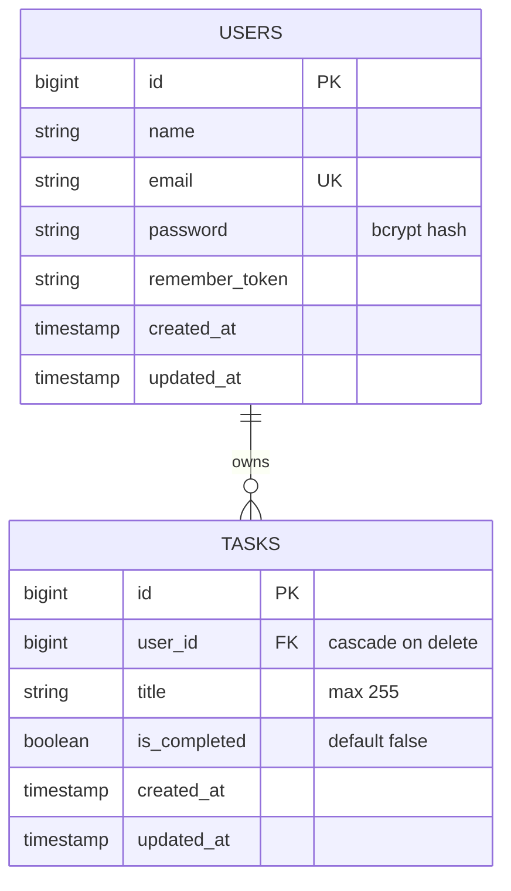

# Architecture — School To-Do

## 1. Overview

A small **Laravel 12** (PHP 8.2+) web application that serves a per-user to-do list.
It follows the standard Laravel MVC request flow: routes → middleware →
controllers → Eloquent models → Blade views. Authentication is **hand-rolled on
Laravel's built-in `Auth`/`Hash`/session** facilities (no Breeze/Jetstream, so there
is **no Node/npm build step** — the UI is plain Blade with inline CSS). Data is
stored in **MySQL** (`school_db`) via XAMPP. A second module lets any logged-in
user manage **all** user accounts (list/add/edit/delete) — see §4 for its access
model.

## 2. Components

| Component | File(s) | Responsibility |
|-----------|---------|----------------|
| **Routes** | `routes/web.php` | Maps URLs to controllers; groups by `guest` / `auth` middleware |
| **RegisteredUserController** | `app/Http/Controllers/Auth/RegisteredUserController.php` | Show register form; validate, create user (hashed pw), auto-login |
| **AuthenticatedSessionController** | `app/Http/Controllers/Auth/AuthenticatedSessionController.php` | Show login form; authenticate; logout + session invalidation |
| **TaskController** | `app/Http/Controllers/TaskController.php` | List / create / toggle / delete tasks, scoped to the current user; `authorizeOwnership()` enforces 404 on foreign tasks |
| **UsersController** | `app/Http/Controllers/UsersController.php` | List (paginated) / create / edit / update / delete **any** user account — no ownership check, open to every logged-in user |
| **User model** | `app/Models/User.php` | Authenticatable; `hasMany(Task)`; `password` cast `hashed` |
| **Task model** | `app/Models/Task.php` | `belongsTo(User)`; `is_completed` cast `boolean`; fillable `title`,`is_completed` |
| **Migrations** | `database/migrations/*` | `users`, `tasks` (+ Laravel default cache/jobs tables) |
| **Layout view** | `resources/views/layouts/app.blade.php` | HTML shell, nav (user + logout), flash + error blocks, inline CSS |
| **Auth views** | `resources/views/auth/{register,login}.blade.php` | Registration and login forms |
| **Task view** | `resources/views/tasks/index.blade.php` | Add-task form, task list, toggle + delete controls, empty state |
| **User views** | `resources/views/users/{index,create,edit}.blade.php` | Users list (paginated), add-user form, edit-user form |
| **TaskFactory** | `database/factories/TaskFactory.php` | Test data generation |

## 3. Request / data flow

Typical authenticated action (e.g. adding a task):

```mermaid
flowchart TD
    A[Browser form POST /tasks] --> B{Middleware}
    B -->|CSRF valid?| C[auth middleware]
    B -->|invalid token| E419[419 Page Expired]
    C -->|guest| L[302 redirect to /login]
    C -->|authenticated| D[TaskController@store]
    D --> V{Validate title\nrequired, max:255}
    V -->|fail| R1[302 back with errors]
    V -->|pass| M[user->tasks()->create()]
    M --> DB[(MySQL school_db\ntasks table)]
    DB --> R2[302 redirect to /tasks + flash]
    R2 --> IDX[TaskController@index]
    IDX --> Q[user->tasks()->latest()->get()]
    Q --> DB
    DB --> VW[Render tasks.index Blade]
    VW --> HTML[HTML page to browser]
```

**Authorization (toggle/delete):** `TaskController` loads the task via route-model
binding, then `authorizeOwnership()` calls `abort_if($task->user_id !== current user, 404)`.
A user acting on someone else's task gets a **404** and the owner's data is untouched.

**Data relationship:**



Deleting a user cascades to their tasks (`cascadeOnDelete` on the `user_id` FK).

## 4. Security model

- **Authentication** — Laravel session auth via `Auth::attempt()` / `Auth::login()`.
  Session is regenerated on login and registration; invalidated on logout.
- **Authorization / tenant isolation** — all task queries go through
  `$request->user()->tasks()`; cross-user access returns 404.
- **User management access control (gap, by design for now)** — `/users` routes
  check only `auth` (logged in), not role/ownership: **any logged-in user can list,
  create, edit, or delete any other account**, because this version has no admin
  role (REQUIREMENTS v2 §2). The one guard in place is self-protection: `destroy()`
  returns **403** if the target id equals the current user's id, so you cannot
  delete your own account. Flagged by development as an open decision — gating
  via an `is_admin` column is the proposed fix, not yet built or specified.
- **Password storage** — `Hash::make()` on register/create plus `'password' =>
  'hashed'` cast; bcrypt rounds = 12. Never stored or logged in plain text. On
  user edit, the password is only re-hashed and saved when a new one is submitted;
  a blank field leaves the stored hash untouched.
- **CSRF** — Laravel's `VerifyCsrfToken` on all web routes; every mutating form
  carries `@csrf`. Missing token → 419.
- **SQL injection** — Eloquent / parameter-bound queries only; no raw SQL.
- **XSS** — all dynamic output rendered through Blade `{{ }}` auto-escaping.
- **Mass assignment** — `Task::$fillable` limited to `title`, `is_completed`; the
  completion value is set server-side in the toggle, never from request input.
  `UsersController` builds `User::create()`/`$user->save()` from individually
  validated fields rather than a mass `$fillable` array.

## 5. Folder structure (project-specific parts)

```
todo-app/
├── app/
│   ├── Http/Controllers/
│   │   ├── TaskController.php
│   │   ├── UsersController.php
│   │   └── Auth/
│   │       ├── RegisteredUserController.php
│   │       └── AuthenticatedSessionController.php
│   └── Models/
│       ├── Task.php
│       └── User.php
├── database/
│   ├── migrations/
│   │   ├── 0001_01_01_000000_create_users_table.php
│   │   ├── 0001_01_01_000001_create_cache_table.php
│   │   ├── 0001_01_01_000002_create_jobs_table.php
│   │   └── 2026_11_11_153300_create_tasks_table.php
│   └── factories/TaskFactory.php
├── resources/views/
│   ├── layouts/app.blade.php
│   ├── auth/{register,login}.blade.php
│   ├── tasks/index.blade.php
│   └── users/{index,create,edit}.blade.php
├── routes/web.php
├── tests/Feature/{AuthTest,TaskTest,UserManagementTest}.php
├── .env / .env.example      (MySQL school_db)
└── (standard Laravel bootstrap/, config/, public/, vendor/ …)
```

## 6. Design decisions & rationale

- **Hand-rolled auth instead of Breeze** — keeps the stack to plain Blade + inline
  CSS, avoiding a Node/npm/Vite build. Simpler to run and read for a school project
  while still using Laravel's standard auth/session/hashing internals.
- **Single task page** — add form, list, toggle, and delete live on one view
  (`tasks/index.blade.php`) for a minimal UI.
- **404 (not 403) for foreign tasks** — avoids disclosing that another user's task
  id exists; the requirements permit "403 / not found".
- **Progressive-enhancement trade-off** — toggle (checkbox auto-submit) and delete
  (`confirm()`) depend on JavaScript; accepted for the stated simple desktop UI
  (see known issues in CHANGELOG).
- **User management open to all logged-in users, not gated by role** — the module
  reuses the existing `auth` middleware rather than introducing a new role/
  permission layer, since REQUIREMENTS v2 has no admin role. Simplest option
  for now; the only safety rail added is blocking self-deletion. See §4 for the
  open decision this creates.

## 7. Testing

Feature tests run on **in-memory SQLite** (via `phpunit.xml`, `RefreshDatabase`) and
do **not** touch `school_db`:

- `tests/Feature/AuthTest.php` — register/login/logout, validation, guest redirect,
  password hashing.
- `tests/Feature/TaskTest.php` — add/validation/255-cap, list scoping, empty state,
  toggle, delete, newest-first ordering, cross-user 404.
- `tests/Feature/UserManagementTest.php` — listing requires auth, create
  validation + unique email + hashing, edit email-ignore-self + optional
  password, delete another user, cannot delete own account.

QA added a supplementary suite (`agents/qa/.../tests/QaExtraTest.php`). Total: **31
automated tests passing**. Run with `php artisan test`.

## Document Version History

| Version | Date | Author | Description of changes |
|---|---|---|---|
| 1 | 2026-11-12 | Technical Writer | Initial release |
| 2 | 2026-11-12 | Technical Writer | Added `UsersController` and the user views to the components table; documented the user-management access-control gap (no admin role, self-delete blocked) in §4; added `users/*` to the folder structure and `UserManagementTest.php` to §7; updated test total to 31. |
